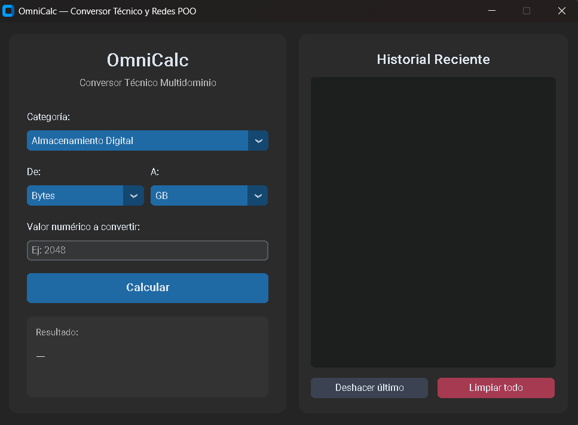
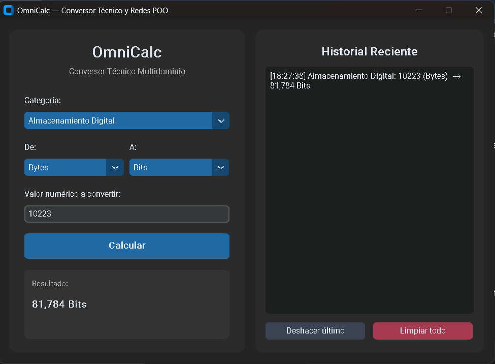
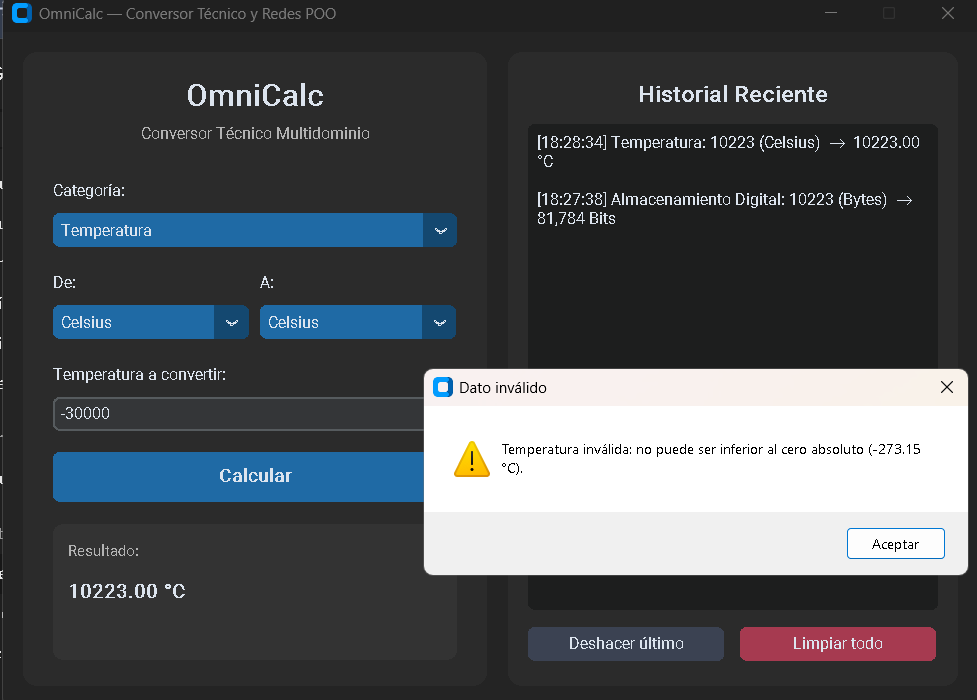

# OmniCalc — Sistema de Conversión Técnica y Cálculo de Subredes IPv4


**OmniCalc** es una aplicación de escritorio desarrollada en **Python** bajo el paradigma de **Programación Orientada a Objetos (POO)** y una arquitectura desacoplada en tres capas. El sistema resuelve operaciones técnicas de ingeniería —conversión de almacenamiento digital binario, transformación de escalas termométricas con validación física y análisis de redes IPv4 mediante notación CIDR—, integrando una pila de historial en memoria y una suite de pruebas unitarias automatizadas.

---

## Arquitectura y Organización del Proyecto

El código fuente sigue el principio de **Separación de Responsabilidades (SoC)**, aislando las reglas de negocio de la interfaz gráfica:

```text
omnicalc-poo/
├── docs/
│   ├── imagenes/
│   │   ├── inicio.png           # Vista principal de la interfaz
│   │   ├── conversion.png       # Ejecución de conversión e historial activo
│   │   └── error.png            # Manejo visual de excepciones
│   └── INFORME_TECNICO.md       # Documentación de diseño, UML y pruebas
├── interfaz.py                  # Capa de Presentación (CustomTkinter)
├── main.py                      # Punto de entrada de ejecución
├── modelos.py                   # Capa de Dominio (Entidades y reglas POO)
├── pruebas.py                   # Suite de pruebas unitarias (unittest)
├── servicios.py                 # Capa de Servicios (Orquestación e historial LIFO)
├── requirements.txt             # Especificación de dependencias
├── .gitignore                   # Exclusión de entornos y archivos temporales
└── README.md                    # Documentación general del repositorio
```

### Responsabilidad por Módulo

| Módulo | Capa Arquitectónica | Clases Principales | Responsabilidad Técnica |
| :--- | :--- | :--- | :--- |
| `modelos.py` | **Dominio** | `OperacionConversion`, `ConversionDatos`, `ConversionTemperatura`, `CalculoSubredIP`, `RegistroOperacion` | Define el contrato abstracto de cálculo, las fórmulas matemáticas/de red, el encapsulamiento de datos y las validaciones de rango. |
| `servicios.py` | **Servicios** | `CalculadoraServicio` | Orquesta la ejecución polimórfica de operaciones y administra el historial en una pila LIFO acotada. |
| `interfaz.py` | **Presentación** | `OmniCalcApp` | Gestiona la ventana gráfica, captura eventos del usuario y presenta alertas controladas ante excepciones. |
| `pruebas.py` | **Calidad / QA** | `TestOmniCalc` | Verifica de forma aislada y automatizada el comportamiento del dominio y los servicios sin depender de la GUI. |

---

## Diseño Orientado a Objetos y Principios SOLID

* **Abstracción:** `OperacionConversion(ABC)` define la interfaz contractual `@abstractmethod def ejecutar(self, dato: str) -> str`, impidiendo la instanciación de operaciones incompletas.
* **Herencia:** `ConversionDatos`, `ConversionTemperatura` y `CalculoSubredIP` extienden `OperacionConversion`, reutilizando atributos protegidos (`_nombre`, `_unidad_origen`, `_unidad_destino`) y propiedades de acceso.
* **Polimorfismo y Principio Abierto/Cerrado (OCP):** El método `CalculadoraServicio.procesar(operacion, dato)` invoca `operacion.ejecutar()` sin acoplarse a una subclase específica. Esto permite incorporar nuevas categorías de conversión sin alterar la capa de servicios ni la interfaz.
* **Encapsulamiento:** Los atributos internos (`__historial`, `__FACTORES_A_BITS`, `__hora`) son privados y se exponen únicamente mediante propiedades de solo lectura (`@property`) y métodos controlados.

---

## Guía de Instalación y Ejecución

### Requisitos Previos
* Python 3.10 o superior.
* Gestor de paquetes `pip`.

### Pasos de Despliegue Local

1. **Clonar el repositorio:**
   ```bash
   git clone [https://github.com/alexdrileones-bot/omnicalc-poo.git](https://github.com/alexdrileones-bot/omnicalc-poo.git)
   cd omnicalc-poo
   ```

2. **Crear y activar un entorno virtual:**
   ```bash
   python -m venv .venv
   # En Windows:
   .venv\Scripts\activate
   # En Linux / macOS:
   source .venv/bin/activate
   ```

3. **Instalar dependencias:**
   ```bash
   pip install -r requirements.txt
   ```

4. **Ejecutar la aplicación:**
   ```bash
   python main.py
   ```

5. **Ejecutar la suite de pruebas unitarias:**
   ```bash
   python -m unittest pruebas.py -v
   ```

---

## Evidencias de Funcionamiento

### 1. Interfaz Gráfica Principal


### 2. Procesamiento de Conversiones e Historial LIFO


### 3. Validación Preventiva y Manejo de Excepciones


---

## Documentación Técnica Completa
Para revisar el **diagrama de clases UML**, el análisis de complejidad del historial y la matriz de casos de prueba, consulta el **[Informe Técnico de Arquitectura](docs/INFORME_TECNICO.md)**.