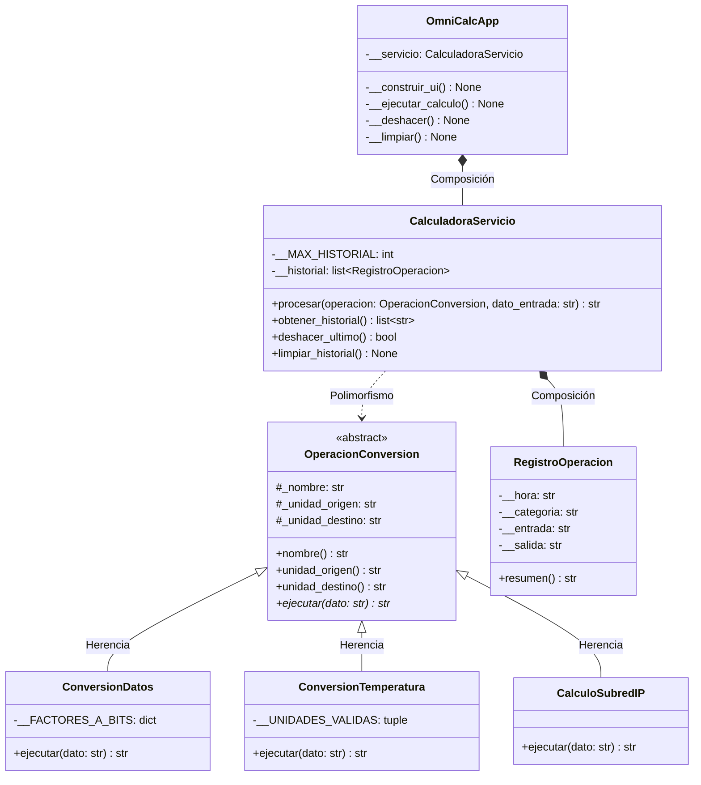

# Informe Técnico: Arquitectura y Diseño Orientado a Objetos de OmniCalc

**Proyecto:** OmniCalc — Conversor Técnico Multidominio y Calculadora de Subredes IPv4  
**Lenguaje y Entorno:** Python 3.10+ | CustomTkinter | Unittest  
**Paradigma:** Programación Orientada a Objetos (POO) — Arquitectura en 3 Capas  

---

## 1. Introducción y Alcance
**OmniCalc** es una solución de software de escritorio diseñada para automatizar cálculos técnicos recurrentes en ingeniería de sistemas y redes:
1. Conversión exacta de unidades de almacenamiento digital bajo el estándar binario ($1\text{ KB} = 1024\text{ Bytes}$).
2. Conversión bidireccional entre escalas termométricas (*Celsius*, *Fahrenheit* y *Kelvin*) respetando restricciones termodinámicas.
3. Cálculo de direccionamiento IPv4 mediante notación CIDR (dirección de red, máscara decimal, dirección de *broadcast* y cantidad de *hosts* utilizables).

---

## 2. Arquitectura del Sistema
El diseño aplica una **arquitectura en tres capas** con flujo unidireccional de dependencias (`Presentación → Servicios → Dominio`). La capa de dominio no posee importaciones de bibliotecas gráficas, lo que garantiza portabilidad y testabilidad unitaria.

```text
+---------------------------------------------------------------+
|               CAPA DE PRESENTACIÓN (interfaz.py)              |
|   OmniCalcApp (CustomTkinter): captura entradas y muestra UI  |
+-------------------------------+-------------------------------+
                                | invoca servicios y captura ValueError
                                v
+---------------------------------------------------------------+
|                CAPA DE SERVICIOS (servicios.py)               |
|  CalculadoraServicio: ejecución polimórfica y pila LIFO       |
+-------------------------------+-------------------------------+
                                | opera sobre contratos abstractos
                                v
+---------------------------------------------------------------+
|                 CAPA DE DOMINIO (modelos.py)                  |
|  OperacionConversion (ABC) y subclases especializadas         |
+---------------------------------------------------------------+
```

---

## 3. Diagrama de Clases UML



---

## 4. Aplicación de Pilares de POO y Principios SOLID

### 4.1 Abstracción y Herencia (`modelos.py`)
La clase base `OperacionConversion` hereda de `abc.ABC` y declara el método abstracto `ejecutar(dato: str) -> str`. Esto impone un contrato uniforme para todas las operaciones del sistema, centralizando los metadatos comunes (`_nombre`, `_unidad_origen`, `_unidad_destino`) en el constructor padre mediante `super().__init__()`.

### 4.2 Polimorfismo y Principio Abierto/Cerrado (`servicios.py`)
En `CalculadoraServicio.procesar(operacion: OperacionConversion, dato_entrada: str)`, el servicio recibe cualquier objeto que implemente la interfaz `OperacionConversion`. Durante la ejecución en tiempo de corrida, Python resuelve dinámicamente el método `ejecutar()` correspondiente a la subclase instanciada, permitiendo extender el catálogo de cálculos sin modificar el código existente.

### 4.3 Encapsulamiento y Estructura de Datos LIFO
* **Inmutabilidad del registro:** `RegistroOperacion` protege la marca de tiempo (`__hora`), la categoría, la entrada y el resultado como atributos privados, exponiendo únicamente una representación formateada a través de `@property def resumen`.
* **Gestión acotada de memoria:** `CalculadoraServicio` administra `__historial` como una pila **LIFO** (*Last-In, First-Out*) con un límite máximo de 15 registros (`__MAX_HISTORIAL = 15`). La operación `deshacer_ultimo()` extrae el elemento más reciente en tiempo constante $O(1)$ mediante `list.pop()`.

---

## 5. Estrategia de Validación y Manejo de Excepciones
El dominio valida todas las entradas antes de realizar cualquier cómputo y lanza excepciones `ValueError` específicas, las cuales son interceptadas por la capa de presentación para notificar al usuario sin interrumpir el ciclo de eventos de la aplicación:

| Categoría | Condición de Error | Excepción Lanzada | Mensaje de Control |
| :--- | :--- | :--- | :--- |
| **General** | Entrada no numérica o vacía | `ValueError` | *"Debe ingresar un valor numérico válido."* |
| **Almacenamiento** | Valor negativo ($x < 0$) | `ValueError` | *"El tamaño de datos no puede ser negativo."* |
| **Temperatura** | Inferior al cero absoluto ($T < -273.15\text{ }^\circ\text{C}$) | `ValueError` | *"Temperatura inválida: no puede ser inferior al cero absoluto (-273.15 °C)."* |
| **Subred IPv4** | Ausencia de prefijo `/` o dirección fuera de rango | `ValueError` | *"Ingrese una IP con máscara CIDR..."* / *"Dirección IPv4 o prefijo de red inválido."* |

---

## 6. Matriz de Pruebas Unitarias (`pruebas.py`)
La calidad funcional del núcleo lógico se valida mediante el framework estándar `unittest` en el módulo `pruebas.py`:

| ID | Método de Prueba | Escenario Evaluado | Resultado Esperado | Estado |
| :--- | :--- | :--- | :--- | :--- |
| **TC-01** | `test_conversion_datos_binaria` | Conversión de `2 GB` a `MB` en base binaria ($1024$). | Retorna `"2,048 MB"`. | **PASS** |
| **TC-02** | `test_conversion_datos_negativa_lanza_error` | Intento de convertir `-50 MB` a `KB`. | Lanza `ValueError`. | **PASS** |
| **TC-03** | `test_conversion_temperatura_valida` | Conversión del punto de ebullición (`100 °C` a `°F`). | Retorna `"212.00 °F"`. | **PASS** |
| **TC-04** | `test_temperatura_bajo_cero_absoluto` | Ingreso de `-300 °C` (bajo límite físico). | Lanza `ValueError`. | **PASS** |
| **TC-05** | `test_calculo_subred_ipv4` | Análisis de la dirección `192.168.1.50/24`. | Identifica red `192.168.1.0` y `254` hosts útiles. | **PASS** |
| **TC-06** | `test_historial_lifo_deshacer` | Inserción de 2 operaciones y ejecución de `deshacer_ultimo()`. | Reduce el historial a 1 elemento (el primero). | **PASS** |
